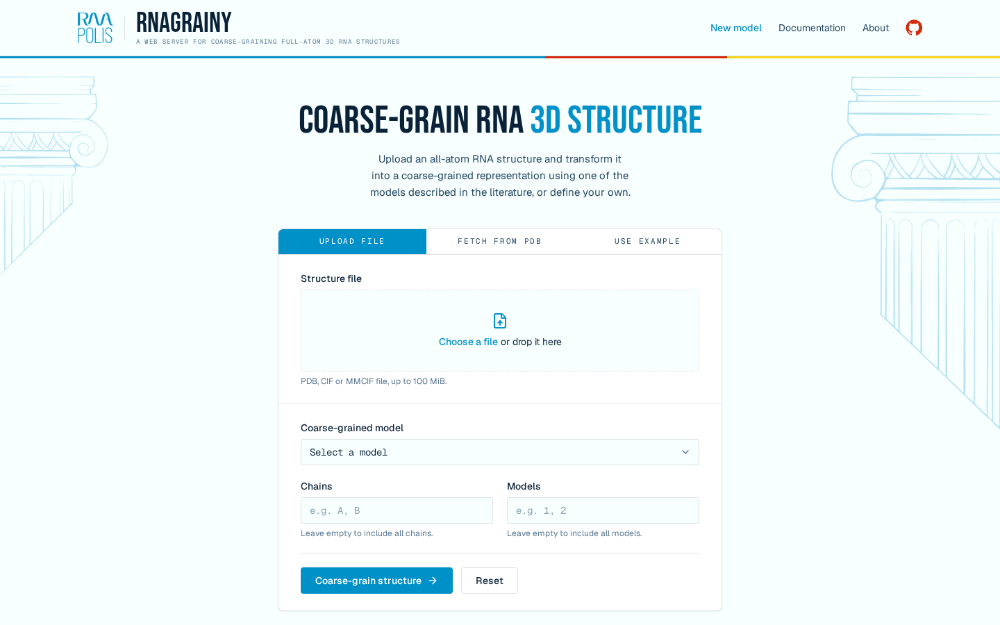
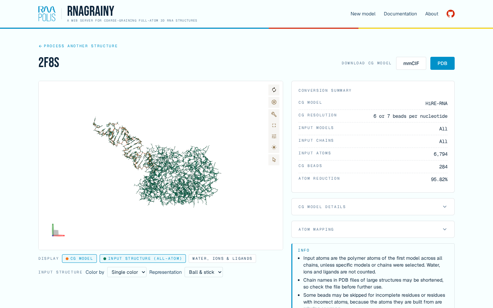
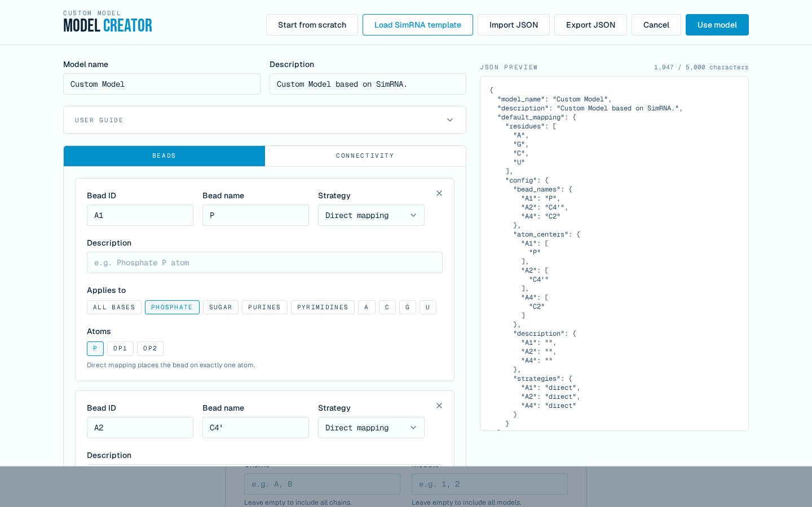
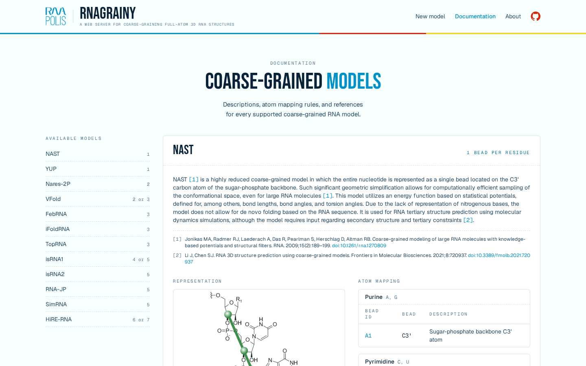

# RNAgrainy

> A universal platform for generating, visualizing, and comparing coarse-grained RNA structure models.

[**Open RNAgrainy**](https://rnagrainy.cs.put.poznan.pl/) ·
[**Documentation**](https://rnagrainy.cs.put.poznan.pl/documentation/) ·
[**API**](#public-api)


## About

RNAgrainy is a web-based bioinformatics platform for generating, visualizing, and comparing coarse-grained representations of RNA structures.

The application enables the transformation of all-atom RNA structures into simplified coarse-grained representations using multiple models described in the scientific literature. It also provides tools for defining custom coarse-grained representations.

## Scientific Background

RNA molecules play essential roles in many biological processes, and understanding their structure and dynamics is important for studying their function.

All-atom molecular representations provide detailed structural information but may become computationally expensive when used in simulations of large RNA molecules or over long timescales. Coarse-grained models reduce the number of interaction sites by representing groups of atoms as simplified particles or pseudoatoms.

Different coarse-grained RNA models use different mapping strategies, resolutions, and representations. RNAgrainy provides a unified environment for generating and comparing these representations from the same input RNA structure.

## Key Features

* **Structure import:** Support for PDB and PDBx/mmCIF files, as well as direct retrieval of structures from the RCSB PDB database using a PDB ID. Predefined example structures can also be selected.
* **Coarse-grained model selection:** Selection of predefined RNA coarse-grained models described in the scientific literature.
* **Chain and structure model selection:** Users can select specific chains and structural models from the input structure.
* **Interactive visualization:** Comparison of the original all-atom structure and the generated coarse-grained representation using the Mol* molecular visualization library.
* **Custom model creator:** Define custom coarse-grained representations, pseudoatom mappings, and connectivity rules through an interactive editor, or load an existing model configuration from JSON.
* **Structure export:** Generated coarse-grained structures can be exported in standard PDB and PDBx/mmCIF formats.
* **Model documentation:** The application provides descriptions of supported coarse-grained models, atom mapping rules, and references to the original scientific literature.

## Supported Models

RNAgrainy currently supports the following predefined coarse-grained RNA models:

`NAST` · `YUP` · `Nares-2P` · `VFold` · `FebRNA` · `iFoldRNA` ·
`TopRNA` · `isRNA1` · `isRNA2` · `RNA-JP` · `SimRNA` · `HiRE-RNA`

Detailed descriptions, mapping rules, and references are available in the
[model documentation](https://rnagrainy.cs.put.poznan.pl/documentation/).

## Application Preview

### Main page



### Coarse-grained structure comparison



### Custom coarse-grained model creator



### Model documentation



## Public API

RNAgrainy provides a public HTTP API for coarse-graining structures without using
the web interface. No account or API key is required.

- **Server:** `https://rnagrainy.cs.put.poznan.pl`
- **Interactive API documentation:** [Swagger UI](https://rnagrainy.cs.put.poznan.pl/docs)

Conversion requests use `multipart/form-data`. A successful request returns HTTP
`200` with a JSON result after processing finishes, including a `workspace_id`,
conversion statistics and paths for downloading the generated files.

| Method | Endpoint | Description |
| ------ | -------- | ----------- |
| `GET` | `/api/config` | Supported formats, upload limits and preset IDs |
| `GET` | `/api/models` | Available coarse-grained models and their IDs |
| `POST` | `/api/coarse-grain/file` | Coarse-grain an uploaded PDB or mmCIF file |
| `POST` | `/api/coarse-grain/preset` | Coarse-grain a built-in example structure |
| `POST` | `/api/coarse-grain/rcsb` | Fetch a structure from RCSB PDB and coarse-grain it |
| `POST` | `/api/models/custom/validate` | Validate a custom model definition |
| `GET` | `/api/results/{workspace_id}` | Retrieve conversion metadata for an existing result |
| `GET` | `/api/results/{workspace_id}/{file_type}` | Retrieve a reference or CG file; requires `file_format` |
| `POST` | `/api/results/{workspace_id}/consumed` | Mark a result for cleanup after a grace period |

### Find and select a model

The following examples use Bash, `curl` and `jq`. Run them in a directory where you
want to save the responses and generated structures.

```bash
BASE="https://rnagrainy.cs.put.poznan.pl"

curl --fail-with-body -sS "$BASE/api/models" -o models.json
jq -r '.[] | [.id, .name] | @tsv' models.json
```

Use the model's **`id`**, rather than its display name, as `selected_model`.
For example, the ID for SimRNA is `SimModel`:

```bash
MODEL="SimModel"

curl --fail-with-body -sS "$BASE/api/config" | jq
```

The configuration includes the available `preset_ids` and size limits in bytes.

### Coarse-grain a structure

Choose one of the following sources. Each example saves the JSON response to a
separate file.

**Upload a local file.** Replace `structure.pdb` with your PDB, CIF or mmCIF file:

```bash
curl --fail-with-body -sS "$BASE/api/coarse-grain/file" \
  -F "file=@structure.pdb" \
  -F "selected_model=$MODEL" \
  -o result-file.json
```

**Use a built-in preset:**

```bash
curl --fail-with-body -sS "$BASE/api/coarse-grain/preset" \
  -F "preset_id=1EHZ" \
  -F "selected_model=$MODEL" \
  -o result-preset.json
```

**Fetch a structure from RCSB PDB:**

```bash
curl --fail-with-body -sS "$BASE/api/coarse-grain/rcsb" \
  -F "rcsb_id=2F8S" \
  -F "selected_model=$MODEL" \
  -o result-rcsb.json
```

To select specific input chains or structural models, add fields such as
`-F "chains=A,B"` and `-F "models=1,2"` to any conversion request. Omit these fields
to include all chains and models. `models` selects model numbers within the input
structure; `selected_model` selects the coarse-graining scheme.

### Use a custom model

Export a model from the Custom Model Creator on the
[RNAgrainy website](https://rnagrainy.cs.put.poznan.pl/), or save the
[example definition](tests/data/custom_model.json) as `custom_model.json`.

Validate the definition first. HTTP `204` means that validation succeeded:

```bash
curl --fail-with-body -sS "$BASE/api/models/custom/validate" \
  -F "custom_model_data=<custom_model.json" \
  -w '\nHTTP %{http_code}\n'
```

Then submit it with `selected_model=custom`:

```bash
curl --fail-with-body -sS "$BASE/api/coarse-grain/preset" \
  -F "preset_id=1EHZ" \
  -F "selected_model=custom" \
  -F "custom_model_data=<custom_model.json" \
  -o result-custom.json
```

The same custom model fields work with `/api/coarse-grain/file` and
`/api/coarse-grain/rcsb`. In these `curl` commands, `<custom_model.json` sends the
file's contents as a text form field; `@structure.pdb` uploads a structure file.

### Download the result

Set `RESULT` to the response file from the request you want to inspect:

```bash
RESULT="result-preset.json"
jq '{workspace_id, atom_counts, files}' "$RESULT"

CG_URL=$(jq -er '.files.coarse_mmcif_url' "$RESULT")
curl --fail-with-body -sS "$BASE$CG_URL" -o coarse.mmcif
```

The returned paths are relative to the server, so prepend `$BASE`. The `files`
object also contains `reference_url` for the input structure and `coarse_pdb_url`
for PDB output. PDB output may be unavailable for structures that exceed the
format's limits, in which case `coarse_pdb_url` is `null`:

```bash
PDB_URL=$(jq -r '.files.coarse_pdb_url // empty' "$RESULT")
if [ -n "$PDB_URL" ]; then
  curl --fail-with-body -sS "$BASE$PDB_URL" -o coarse.pdb
fi
```

### Open or share a result page

Results created through the API can also be opened in the web viewer. Use the
returned `workspace_id` to build the link:

```bash
WORKSPACE_ID=$(jq -er '.workspace_id' "$RESULT")
echo "$BASE/results/$WORKSPACE_ID"
```

The link works in a new tab or another browser while the result is still available.
The page retrieves its conversion summary, model details and file paths from
`GET /api/results/{workspace_id}`. You can retrieve the same JSON directly:

```bash
curl --fail-with-body -sS "$BASE/api/results/$WORKSPACE_ID" | jq
```

### Limits, errors and result lifetime

- Structure uploads and RCSB downloads are limited to 100 MiB. Custom model JSON
  is limited to 5,000 characters and 8 KiB of UTF-8 data. Check `/api/config` for
  the current upload and custom model limits.
- Invalid input normally returns HTTP `422` with a JSON `detail` message. Missing
  or expired result files return HTTP `404`. The examples use `--fail-with-body`
  so `curl` returns a nonzero exit code on HTTP errors while retaining the error
  response body.
- Results are temporary. They normally become eligible for cleanup after
  24 hours. Storage pressure may cause older results to be removed sooner, so
  download the files you need promptly.
- After retrieving all needed files, you may optionally POST to the returned
  `files.consumed_url`. This starts a one-hour cleanup grace period; it does not
  delete the result immediately. Ordinary GET requests do not mark a result as
  consumed, and repeated consumed requests do not restart the grace period.
  The web viewer marks a result as consumed after loading its structure files;
  retrieving metadata alone does not start the grace period.

```bash
CONSUMED_URL=$(jq -er '.files.consumed_url' "$RESULT")
curl --fail-with-body -sS -X POST "$BASE$CONSUMED_URL" \
  -w '\nHTTP %{http_code}\n'
```

## Local Development

### Tech stack

- **Backend:** Python 3.12, FastAPI, Pydantic, Gemmi
- **Frontend:** React 19, TypeScript, Vite, Tailwind CSS 4, TanStack Query, React Router,
  Mol*
- **Tooling:** Ruff, mypy, pytest, Playwright, ESLint, Prettier, Vitest, pre-commit
- **Deployment:** Docker, GitHub Actions

### Project structure

```text
app/                  FastAPI backend
  coarse_grain/       coarse-graining algorithm and model definitions
  routes/             JSON API endpoints and the frontend catch-all route
  services/           structure loading, coarse-graining, and result workspaces
  static/             example structures and model images
frontend/             React + TypeScript frontend (Vite)
  src/api/            typed API client and TanStack Query hooks
  src/features/       upload form, model creator, results viewer, model docs
  src/pages/          routed pages (home, results, documentation, about)
  src/components/     layout, brand, and shared UI components
tests/                backend unit, integration, and Playwright E2E tests
docs/screenshots/     screenshots used in this README
```

### Requirements

Install the following tools:

- Python 3.12
- Pipenv
- Node.js 24 with npm
- Docker with Docker Compose

### Install dependencies

Install Pipenv:

```bash
python -m pip install pipenv==2026.6.2
```

Install Python dependencies, including development tools:

```bash
pipenv sync --dev
```

Install frontend dependencies:

```bash
cd frontend
npm ci
```

Install the Git hooks configured by the project:

```bash
pipenv run pre-commit install
```

### Start the development environment

Start the backend in the first terminal:

```bash
pipenv run uvicorn app.main:app --port 5050 --reload
```

Start the frontend dev server in a second terminal:

```bash
cd frontend
npm run dev
```

The application is available at `http://127.0.0.1:5173`. The Vite dev server proxies
the API to `http://127.0.0.1:5050`; override it with the `BACKEND_URL` environment
variable.

### Run the production build

Build the frontend and let FastAPI serve it:

```bash
cd frontend && npm run build && cd ..
pipenv run uvicorn app.main:app --port 5050
```

Or build and run the Docker image, which builds the frontend itself:

```bash
docker compose -f compose.yaml -f compose.dev.yaml up --build app
```

Either way, the application is available at `http://127.0.0.1:5050`.

### Checks

Backend: `pipenv run ruff check .`, `pipenv run mypy`, and the test suites, run
separately as in CI (Playwright's event loop clashes with the async unit tests when they
share a session; the E2E tests also need a frontend build):

```bash
pipenv run pytest tests/unit
pipenv run pytest tests/integration
pipenv run pytest tests/e2e
```

Frontend, in `frontend/`: `npm run lint`, `npm run format:check`, `npm run typecheck`,
`npm test`.

The pre-commit hooks run the formatters, linters, type checks, and the backend unit and
integration tests together with the frontend checks. GitHub Actions runs all checks,
including the E2E tests and a Docker Compose health check, on every pull request and on
pushes to `main` and `develop`.

## Authors

### Development

[Sergiusz Urbaniak](https://github.com/serguppp)¹, [Michał Konon](https://github.com/mihakon)¹

### Scientific supervision

[Marta Szachniuk](https://www.cs.put.poznan.pl/mszachniuk/site/)¹˒²

¹ Institute of Computing Science, Poznan University of Technology, Poland  
² Institute of Bioorganic Chemistry, Polish Academy of Sciences, Poznan, Poland
